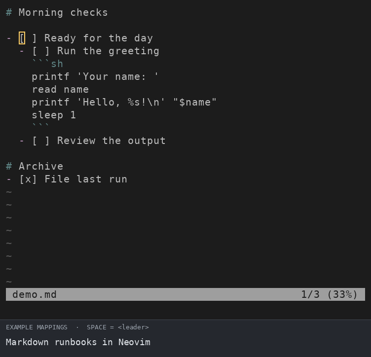

# ☑️ Mark Do

Work through Markdown runbooks in Neovim: check nested tasks, copy code, and run shell fences in a floating terminal.

[](https://github.com/mamachanko/markdo.nvim/actions/workflows/ci.yml)
[](https://github.com/mamachanko/markdo.nvim/releases)

[Installation](#installation) · [Quick start](#quick-start) · [Commands](#commands) · [Behavior](#behavior) · [Help & development](#help-and-development)



*Run a step, review its output, and complete the checklist. Parent tasks update as you go.*

Keep your runbooks as ordinary Markdown, with the checklist and its commands together:

- **Nested tasks** — complete a task from its text or code; parent checkboxes reflect progress below them.
- **Code in context** — copy a fence body or run a shell script directly from the task it belongs to.
- **Interactive execution** — inspect live output, enter terminal input, and keep the result visible after exit.

Mark Do reads the current buffer, including unsaved edits. It works without a setup call and leaves your keys free.

## Requirements

| Dependency | Used for |
| --- | --- |
| **Neovim 0.11+** | All commands; shell execution supports Linux and macOS |
| **Tree-sitter Markdown parser** (`markdown`) | Task scope, fence selection, and headings |
| **Clipboard provider** | Copy only; check `:checkhealth vim.provider` |
| **Shell executable** | Run only; `sh`, `bash`, `zsh`, `fish`, or Neovim's configured shell |

Official Neovim releases include the Markdown block parser. If your distribution omits it, install it with `:TSInstall markdown` using nvim-treesitter, or add a compatible `parser/markdown.so` to your runtimepath. Mark Do reports a missing parser.

For clipboard support, install a platform clipboard tool or configure `g:clipboard`; see `:help clipboard`.

## Installation

### Lazy.nvim

Add this spec to your plugins. **No `setup()` call is needed.**

<!-- example:lazy -->
```lua
{
  'mamachanko/markdo.nvim',
  ft = 'markdown',
}
```

### Native Neovim packages

With Neovim's default Linux/macOS data directory:

<!-- example:native -->
```sh
pack_dir="${XDG_DATA_HOME:-$HOME/.local/share}/nvim/site/pack/plugins/start"
mkdir -p "$pack_dir"
git clone https://github.com/mamachanko/markdo.nvim.git "$pack_dir/markdo.nvim"
```

Restart Neovim, then run `:helptags ALL` to index the help file.

<details>
<summary>Custom data directory or NVIM_APPNAME</summary>

Use `:lua print(vim.fn.stdpath('data'))` to find your data directory. Install the plugin beneath it at `site/pack/plugins/start/markdo.nvim`.

</details>

### Optional keymaps

The following `init.lua` example keeps all four actions under `<leader>x`, only in Markdown buffers. It works with either installation above.

<!-- example:keymaps -->
```lua
vim.api.nvim_create_autocmd('FileType', {
  pattern = 'markdown',
  callback = function(ev)
    for key, action in pairs({
      ['<leader>xx'] = 'Toggle',
      ['<leader>xd'] = 'Done',
      ['<leader>xc'] = 'Copy',
      ['<leader>xe'] = 'Run',
      -- ['<leader>x<Space>'] = 'Run', -- Alternative to <leader>xe.
    }) do
      vim.keymap.set('n', key, '<Plug>(MarkDo' .. action .. ')',
        { buffer = ev.buf, desc = 'Mark Do ' .. action })
    end
  end,
})
```

All letters are lowercase. To use `<leader>x<Space>` for Run, replace the `<leader>xe` entry with the commented entry above. `<Plug>` mappings resolve when the plugin loads.

## Quick start

Open [examples/runbook.md](examples/runbook.md), or save the following as `morning.md`:

<!-- example:runbook -->
````markdown
# Morning checks

- [ ] Ready for the day
  - [ ] Run the greeting
    ```sh
    name=Neovim
    printf 'Hello, %s!\n' "$name"
    sleep 1
    ```
  - [ ] Review the output
````

1. **Run.** Place the cursor on **Run the greeting** (line 4), or inside its fence, and use `:MarkDoRun`. The float prints `Hello, Neovim!`, pauses one second, and shows `exit 0`. The task stays open.
2. **Return.** Press **Ctrl-\**, then **Ctrl-N** to leave terminal mode. Press **q** to close the completed float.
3. **Copy and complete.** Back on **Run the greeting**, use `:MarkDoCopy` to copy the three script lines. Use `:MarkDoDone` to check that child. The parent stays open.
4. **Finish.** Move to **Review the output** (line 10) and use `:MarkDoDone`. The last child and its parent check together:

<!-- example:completed -->
```markdown
- [x] Ready for the day
  - [x] Run the greeting
    …
  - [x] Review the output
```

Toggle either child with `:MarkDoToggle` and the parent reopens. One undo reverses both changes.

The fence belongs to **Run the greeting**, so put the cursor on that child to Copy or Run. Selecting the parent does not select its children's fences.

## Commands

| Command | Example key | Action |
| --- | --- | --- |
| `:MarkDoToggle` | `<leader>xx` | Reverse the current task |
| `:MarkDoDone` | `<leader>xd` | Check the current task; checked tasks stay checked |
| `:MarkDoCopy` | `<leader>xc` | Copy the selected fence body to the `+` register |
| `:MarkDoRun` | `<leader>xe` | Run the selected shell fence in a float |

Example keys come from the [optional keymaps](#optional-keymaps) above. The plugin assigns none by default. Commands and mappings are buffer-local to Markdown, including buffers open before the plugin loads.

<details>
<summary>&lt;Plug&gt; mapping reference</summary>

Use these normal-mode mappings in your own key configuration:

| Mapping | Command |
| --- | --- |
| `<Plug>(MarkDoToggle)` | `:MarkDoToggle` |
| `<Plug>(MarkDoDone)` | `:MarkDoDone` |
| `<Plug>(MarkDoCopy)` | `:MarkDoCopy` |
| `<Plug>(MarkDoRun)` | `:MarkDoRun` |

</details>

## Behavior

### Tasks and parent completion

The innermost checkbox item containing the cursor is the current task. Its scope includes continuation paragraphs, nested plain lists, and fenced code. Ordered and unordered lists support `[ ]`, `[x]`, and `[X]`; checking writes `[x]`. Checkbox text inside code is treated as code. Blank separators between sibling items and positions outside tasks leave the buffer unchanged and report a short message.

After a checkbox changes, Mark Do recomputes its checkbox ancestors from the bottom up. A parent checks when **all descendant tasks are checked**, and reopens when any are open. Plain list items can contain tasks but have no checkbox state.

Editing a parent with Done or Toggle leaves its descendants alone; the next changed descendant recomputes the parent. Manual text edits do not trigger updates. Each command changes only checkbox characters, preserves the cursor, and forms **one undo step**, including parent changes.

### Fence selection

Copy and Run share the same selection rules:

| Cursor location | Selected fence |
| --- | --- |
| On or inside a fence, including either delimiter | That fence |
| In a task | A fence whose nearest checkbox ancestor is that task |
| Outside tasks and fences | The next fence outside any task, before the next heading |

If a task owns several fences, `vim.ui.select` shows each fence's language, opening line number, and first nonblank body line. Child-task fences belong to the child. Outside tasks, a heading of any level ends the search; before the first heading, only the preamble is searched.

Cancelling the picker does nothing. Editing or deleting the source while it is open cancels the action and asks you to retry. No match, an incomplete fence, or an empty body produces a short message. An unusable selection never falls through to another fence.

### Copying code

Backtick and tilde fences are supported, with any language label or none. Mark Do removes delimiters, the label, Markdown container prefixes, and fence indentation. **Script-relative indentation, blank lines, quotes, and comments are preserved.**

Copy writes characterwise text to `+` without adding a final newline; existing blank final body lines remain. A missing clipboard provider reports a message and leaves other registers alone.

### Running shell fences

The first word of the fence's info string selects the interpreter:

| Label | Invocation |
| --- | --- |
| `sh`, `bash`, `zsh`, `fish` | Named executable with the entire body as one `-c` argument |
| `shell` | Neovim's `shell` and `shellcmdflag` options |

Each Run starts a fresh asynchronous terminal job, inherits Neovim's environment, and uses the **originating window's effective working directory**, including `:lcd` and `:tcd`. Variables and `cd` persist across lines within that run. An unlabelled or unsupported fence, or a missing executable, reports an error.

Scripts run only when you explicitly invoke Run. Exit status never changes the checklist. Output stays visible after exit, with the code in the float title and `b:markdo_exit_code`.

The float opens in terminal mode for live input. One job may be active per Neovim instance; a second Run focuses it.

| Terminal keys | Action |
| --- | --- |
| **Ctrl-\**, then **Ctrl-N** | Enter terminal-buffer Normal mode |
| **x** in Normal mode | Stop the job and keep its output |
| **q** in Normal mode | Close the float after exit |

Closing the float another way stops an active job and cleans up its buffer. Background job management is deferred.

## Help and development

- **Reference:** `:help markdo`
- **Release notes:** [GitHub Releases](https://github.com/mamachanko/markdo.nvim/releases)
- **Release process:** [Version rules and squash-merge guidance](docs/releases.md)
- **Demo:** [Recording instructions](docs/demo.md) for the real Neovim UI capture above

From the repository root, with Neovim and its Markdown parser:

```sh
nvim --headless -u NONE -l tests/run.lua
nvim --headless -u NONE -l tests/readme.lua
```

CI tests Neovim **0.11.0** and **current stable** on Linux and macOS, including fork pull requests. Tests use real parsing, a fake clipboard provider, and harmless terminal jobs.

<details>
<summary>Check release tooling locally</summary>

With Node.js 24.10+:

```sh
npm ci
npm run test:release
```

These checks use throwaway Git histories. See [release maintenance](docs/releases.md) for the version policy and test cases.

</details>

## License

[MIT](LICENSE) © Max Brauer
